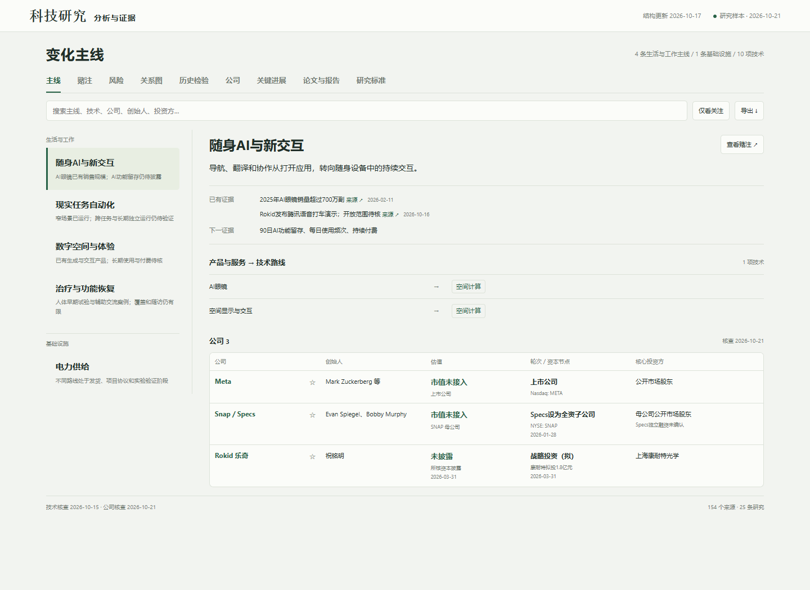

# AI辅助科技研究与可视化分析

我用这个网站跟踪科技进展，整理相关论文和公司，也保留自己以前的判断。资料更新后，可以回头看看哪些想法需要修改。



## 运行

Python 3.10+，标准库即可构建；Node.js 18+用于交叉校验情景计算。

```sh
python build_radar.py
python -m http.server 8000 --directory docs
```

打开 http://localhost:8000 ，也可直接打开 `docs/index.html`。

```sh
python -m unittest test_system -v
node test-system.cjs
```

## 可以看什么

- 技术进展：相关论文、已经验证的结果、仍待解决的问题。
- 公司资料：产品、融资和各项信息的原始出处。
- 历次判断：当时参考了什么证据，后来发生了什么变化。
- 关系图：技术、公司和岗位之间的联系。

每条研究保留原文链接、事件日期和实际阅读范围。本次公开样本截至2026-10-21。网页支持筛选、详情查看和JSON导出；修改证据或判断后，构建程序会保存新快照，供以后回看。

## 开发过程

研究方向、页面安排和资料记录规则由我确定。开发过程中，我用AI辅助编写Python和JavaScript代码，并逐轮检查页面、数据和计算结果。

## 数据与方法

本仓库是独立公开版本。样本来自原研究的公开资料及作者整理，保留各条来源与阅读范围。MIT许可适用于代码，第三方论文和网页仍按原权利与条款使用。

`odds-v1`为人工证据情景：先验、相关性系数与证据分数未经经验校准。界面保留事件定义、期限和敏感性范围；历史资料重建与真正前向记录分别维护。详细说明见[架构与方法](ARCHITECTURE.md)。

新增数据后重新构建。浏览器关注与判断记录保存在本机，可导出，不写回研究事实源。

## 发布演示

在GitHub仓库的 Settings → Pages 中选择 GitHub Actions，运行 Demo 工作流。`docs/`包含完整静态演示；源代码、样本、测试和构建过程均在本仓库。
